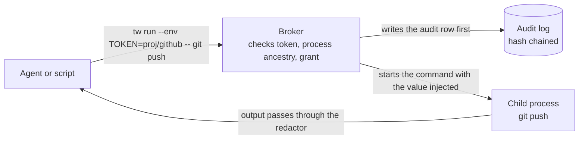
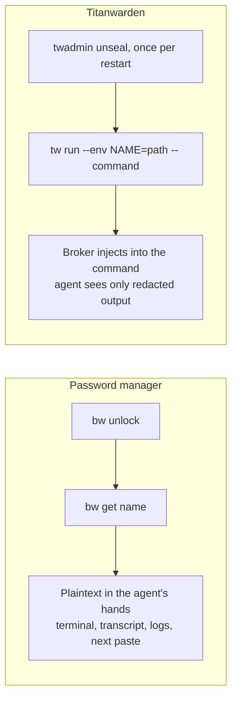
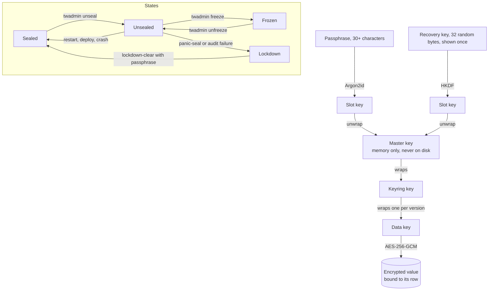
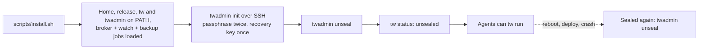
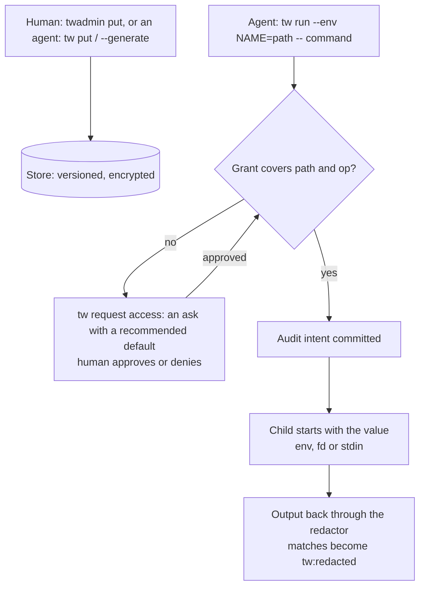
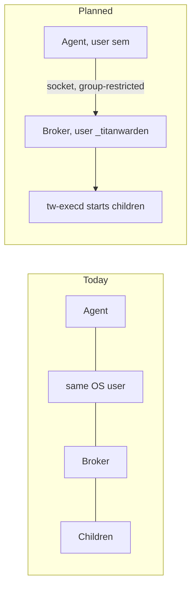

# Titanwarden guide

A secret broker for machines where AI agents work: use, never see. This guide is for an engineer setting it up on their own machine, and for the humans who operate it. Written 2026-11-04 from the PRD, the threat model and the code; update it when a part changes.

Contents: [Titanwarden in one minute](#one-minute), [What makes it different from a password manager](#different), [How a secret is protected](#protection), [Install it on your own machine](#install), [Give an agent a credential](#agents), [The web console](#console), [The questions people ask](#questions), [Honest limits today](#limits), [When something fails](#failures)

## Titanwarden in one minute

Titanwarden is a secret broker for machines where AI agents do work. An agent never reads a secret. It names the secret it needs and the command it wants to run, and the broker starts that command itself with the value injected into it. The agent-facing protocol has no operation that returns plaintext, so an agent cannot leak a value it never received.

It runs as one small Python service on the machine (a launchd agent on macOS, a systemd unit on Linux), keeps everything encrypted in one SQLite file, and asks a human only for the things only a human should do: the first setup, unsealing after a restart, and reading a value on purpose.



## What makes it different from a password manager

A password manager such as Bitwarden is built for a person: unlock, read, paste. Let an agent use it and the value lands in the agent's terminal, its transcript, its logs and the next tool call. One shared unlock then serves every agent on the machine, so one careless pane exposes everything.

Titanwarden turns that around:

- **Use, never see.** The CLI and the socket have no `get`. The only way to use a secret is to run something with it.
- **Identity first.** Every call carries a token that maps to one named principal, and the broker checks the calling process's ancestry before anything else.
- **Audit is truth.** The audit row commits before a value leaves broker memory. If the audit write fails, the delivery does not happen. "Who touched X last" and "who depends on X" are one command each.
- **Request, do not grab.** An agent without a grant files a request; a human answers it with a recommended default. The broker mediates, people decide.
- **Your human passwords stay where they are.** Titanwarden is not a browser password manager, has no autofill and no TOTP, and its own passphrase is never stored in any other vault.



## How a secret is protected

At rest, the store is envelope encryption with standard parts from one maintained library (pyca cryptography): AES-256-GCM for every value, a random 256-bit master key held only in memory while unsealed, Argon2id for the passphrase (1 GiB memory, 3 passes), HKDF-SHA256 for subkeys. Each secret version has its own data key, wrapped by a keyring key, wrapped by the master key. Every ciphertext is bound to its exact row, so a copied cell cannot be replayed elsewhere.

In operation, the broker has states, and only one of them moves values:

- **Sealed.** Every start, restart, crash or deploy begins here. Keys are not in memory.
- **Unsealed.** A human typed the passphrase (or used the recovery key). Values can be injected.
- **Frozen.** Agent operations latched off by an operator; the latch cannot be cleared by deleting a file.
- **Lockdown.** After a panic seal or an audit verification failure. Keys dropped; a passphrase-authenticated clear is required.

Backups run nightly through SQLite's online backup API and contain ciphertext plus a names-only manifest. A backup opens only with the passphrase or the recovery key.



## Install it on your own machine

You need macOS or Linux, Python 3.12 or newer, `uv`, and SSH access from a device you trust (the setup commands refuse to run inside an agent pane, and the recovery key is printed once on your own terminal).

```sh
git clone <the titanwarden repo> && cd titanwarden
uv sync --frozen
uv run python -m unittest discover -s tests -v     # optional, uses a throwaway TW_HOME under /tmp
scripts/install.sh
```

`install.sh` creates the home (`~/.titanwarden` on macOS, `/data/titanwarden` on Linux, or `TW_HOME` if set) with `state`, `run`, `tokens`, `panes`, `log`, `backups` and `releases` at mode 700, builds a release, links `tw` and `twadmin` into `~/bin`, and loads three jobs: the broker, a 60-second watch, and a 03:17 backup. On Linux the units are system units and `/etc/profile.d/titanwarden.sh` exports `TW_HOME` for SSH sessions.

Then the human ceremony, over SSH from your own device:

```sh
twadmin init        # passphrase twice (at least 30 characters), prints the recovery key once: record it offline
twadmin unseal      # passphrase; the broker now serves agents
tw status           # broker version, seal state, your principal
```

Every restart returns the broker to sealed. After a reboot, a deploy, or a crash: type the vault passphrase on the console's first page (it unseals the vault and reactivates your passkey), or run `twadmin unseal` over SSH. `tw.console_setup` over SSH is only for the first passkey enrollment.



## Give an agent a credential

Put a value in without typing it into an agent pane. A human uses `twadmin put PATH` (hidden prompt). An agent with a `put` grant pipes it in or has the broker generate it, so the value never appears in a command line or a response:

```sh
tw put infra/railway-token            # value on stdin; refuses a terminal unless --prompt
tw put infra/db-password --generate 32 --charset urlsafe
tw names infra                        # names, class, version, length bucket: never values
```

Use it. Prefer a file descriptor or stdin over an environment variable when the tool allows it; a same-user process can read another process's environment, it cannot read a pipe it was not handed.

```sh
tw run --env GITHUB_TOKEN=infra/github -- gh pr create ...
tw run --fd 3=infra/db-password -- psql --passfile /dev/fd/3 ...
tw run --stdin infra/api-key -- some-tool --key-stdin
tw inject --manifest .env.tw -- npm start      # .env.tw lines: VAR=tw://project/name, or VAR=literal
```

A manifest holds references, not values, so it is safe to commit. When an agent lacks a grant it asks: `tw request access infra/github --ops inject --reason "release 0.2.0"`. The request goes to the human with a recommended default; nothing moves until it is approved. Agents can also hand a worker a narrower, time-limited token (`tw task-token issue`) and kill their own token after a suspected leak (`tw token revoke-self`).



## The web console

The console is the human face. Sign in with a passkey and see the vault state, the secret names, their versions and their last use. From there a signed-in human can put a new value or version, reveal a value with a reason (your passphrase, shown for 30 seconds, one audit row), seal the vault with one button, and unseal it again with the passphrase. Approving requests stays on the command line for now (`twadmin request` over SSH). The broker serves the console on `127.0.0.1:8787` only; on a tailnet it is published with `tailscale serve`, which gives it an HTTPS name that passkeys (WebAuthn) require. A forged header to the local port does not log anyone in. After a restart, the first page is the unseal form: the passphrase unseals the vault and reactivates your passkey; `tw.console_setup` over SSH is only for the first passkey enrollment.

## The questions people ask

**Are there one-offs (one-time shares)?** Designed, not built yet. The spec is the agent-first successor of Bitwarden Send: one secret per link, encrypted with a key that rides in the URL fragment so the relay never sees plaintext, sent through a dedicated mail account, revealed once and burned, with a copy-and-confirm step that writes a timestamped receipt you can show a client. Scheduled for v1.

**Does it sync?** Today one broker serves one machine. Two paths exist in the design: an opt-in cloud broker, where a broker enrolls with an organization console (enrollment code, six matching words checked out of band, passkey approval) and exchanges only ciphertext and signed policy; and, later, a tailnet transport so other hosts call one broker with mutual TLS. Neither puts plaintext anywhere but the unsealed broker's memory.

**Will it sync with 1Password or Bitwarden?** No two-way sync, by design: two sources of truth is how secrets drift. There is a one-way import from Bitwarden, run by a human from a names-only manifest, for moving an item in. 1Password is not in the plan. The flow it does have is outward: Titanwarden as the source of truth that pushes a value to Railway, GitHub Actions, Cloudflare or Coolify (placements, v1) and rotates it end to end.

**Can I read a value myself?** Yes, two ways, both with your passphrase, a reason and an audit row: in the web console (reveal, shown for 30 seconds) or on the command line (`twadmin reveal` over SSH, which refuses to run inside an agent pane). An agent has neither.

## Honest limits today

The design labels every guarantee as a boundary or a guardrail, and the current version is clear about which is which:

- The broker, the agents, the token files and the code all run as the same OS user. A determined same-user process could read a token or inspect a child's environment. Today's version prevents accidents and records honest use; it is not a boundary against a deliberately hostile local agent.
- Output redaction catches known encodings (raw, base64, hex, percent, JSON escaping) across chunk boundaries, but an unknown transform can slip past it. It is a guardrail.
- Interactive programs are not supported under `tw run` (no pseudo-terminal yet).

The planned next version closes the first gap: the broker runs as its own user, a separate exec runner starts children, and auto-unseal removes the human from routine restarts.



## When something fails

Every Titanwarden message on stderr starts with `tw:` and never contains a value. The exit code tells you which layer refused:

| Exit | Meaning | What to do |
|---|---|---|
| 64 | bad arguments or frame | fix the command |
| 69 | broker unreachable | is the job loaded? `tw status`, then the watch log |
| 70 | integrity or audit failure | the store or its log failed verification; stop and check backups |
| 75 | sealed, frozen or busy | `twadmin unseal`, `twadmin unfreeze`, or wait |
| 77 | refused: auth, scope, policy, identity mismatch | request a grant, or check which token file this process found |
| 78 | no identity | the caller has no token file |

A denial never says whether a path exists. The caller learns only "denied".
